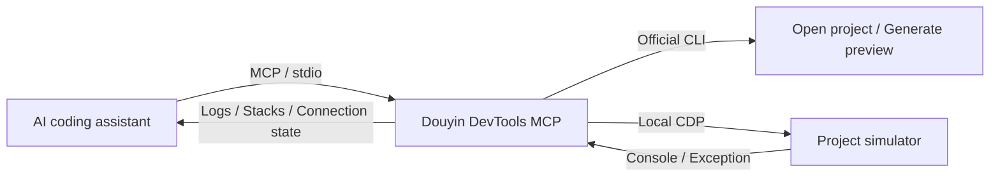

# Douyin DevTools MCP

**Connect your AI coding assistant to Douyin mini-game logs, from diagnosing errors to checking a fix.**

[](LICENSE)
[](package.json)

[简体中文](README.md) · English · [Quick start](#quick-start) · [Tool reference](docs/tools.md) · [Issues](https://github.com/linayanc/DouyinDevToolsMCP/issues)

Douyin DevTools MCP is an open-source [Model Context Protocol (MCP)](https://modelcontextprotocol.io/) server connecting local AI coding clients, such as Codex, to Douyin DevTools. Open projects, inspect Console output and stack traces, follow new logs after recompilation, and generate preview QR codes without repeatedly copying logs into a chat.

Your coding assistant analyzes problems and edits source files. This server supplies IDE operations and runtime logs for Douyin mini-game development.

> **Current version: v0.1.0.** Project opening and runtime logging have been tested on Windows with Douyin DevTools 4.5.6 and official CLI 2.1.1. Native Codex MCP calls have successfully retrieved logs. Unity/Wasm exports, macOS IDE integration, and authenticated preview uploads still need validation. See [compatibility](docs/compatibility.md).

## Features

| MCP tool | Function | Typical use |
| --- | --- | --- |
| `douyin_open_project` | Open a mini-game through the official CLI and attach to its simulator | Start a debugging session |
| `douyin_get_logs` | Read recent Console entries with level and text filters | Inspect runtime context |
| `douyin_get_errors` | Retrieve errors, exceptions, and available stack traces | Locate a reported failure |
| `douyin_watch_logs` | Read entries since the previous read or an explicit cursor | Check output after recompilation |
| `douyin_preview` | Generate a preview QR code through the official CLI | Preview a game with an authorized account |

- **Project isolation:** attach to the simulator associated with the requested project's workbench.
- **Structured output:** return levels, timestamps, stack frames, cursors, and connection state.
- **Incremental debugging:** bounded log storage, pagination, reconnection, and possible-gap reporting.
- **Local integration:** stdio transport for MCP and loopback connections to the IDE.



## Quick start

### 1. Prerequisites

- Node.js **22 or later**, npm, and Git.
- [Douyin DevTools](https://developer.open-douyin.com/docs/resource/zh-CN/mini-game/develop/dev-tools/developer-instrument-update-and-download), installed and running. Windows is the currently tested environment.
- A Douyin mini-game directory containing `project.config.json`, or the included demo.
- A local client supporting stdio MCP servers, running on the same machine as the IDE.

### 2. Install and build

```sh
git clone https://github.com/linayanc/DouyinDevToolsMCP.git
cd DouyinDevToolsMCP
npm ci
npm run build
npm install -g tt-minigame-ide-cli
```

**This project has not been published to npm.** Use the locally built entry point. The official `tt-minigame-ide-cli` is installed separately; version 2.1.1 was tested. If installation resolves to a different version, consult the [compatibility notes](docs/compatibility.md).

With the IDE running, check the environment:

```sh
node dist/index.js --doctor
```

This checks Node, CLI discovery, and the IDE debugging endpoint. Verify the project's actual attachment through `connection.state` after opening it.

### 3. Connect Codex

Add the following to `~/.codex/config.toml` (usually `%USERPROFILE%/.codex/config.toml` on Windows):

```toml
[mcp_servers.douyin]
command = "node"
args = ["D:/tools/DouyinDevToolsMCP/dist/index.js"]
startup_timeout_sec = 15
tool_timeout_sec = 150
```

Replace `args` with your repository's **absolute path**. Forward slashes work for Windows paths. If the client cannot find Node, use the absolute path to `node.exe` as `command`. Restart the client after saving and check that the five tools are available.

If CLI discovery fails, add:

```toml
[mcp_servers.douyin.env]
DOUYIN_CLI_PATH = "C:/Users/YOUR_USER/AppData/Roaming/npm/node_modules/tt-minigame-ide-cli/bin/tmg.js"
```

Run `npm root -g` to locate the global modules directory, then find `tt-minigame-ide-cli/bin/tmg.js` inside it. Use the JavaScript entry point, not `tmg.cmd`. See the [complete template](examples/codex.toml) and [official Codex MCP documentation](https://learn.chatgpt.com/docs/extend/mcp?surface=cli).

### Other MCP clients

For local clients supporting the `mcpServers` format, adapt this configuration according to the client's documentation:

```json
{
  "mcpServers": {
    "douyin": {
      "command": "node",
      "args": ["D:/tools/DouyinDevToolsMCP/dist/index.js"]
    }
  }
}
```

Replace the absolute path and allow at least 150 seconds for preview tool calls. A [configuration with an explicit CLI path](examples/mcp.json) is also included. Other clients have not been individually validated.

## Usage

### Inspect errors and check a fix

Ask your coding assistant, replacing the path with your project directory:

> Open D:/games/my-douyin-game with douyin_open_project and confirm the simulator is connected. Read the latest errors and relevant logs, analyze and fix the problem, then use douyin_watch_logs after recompilation to check new output. Include the connection state when explaining whether the fix was verified.

Typical tool calls follow this sequence. These are MCP argument examples, not terminal commands:

```text
douyin_open_project({"projectPath":"D:/games/my-douyin-game"})
douyin_get_errors({"limit":20})
douyin_get_logs({"contains":"load","limit":50})
douyin_watch_logs({"waitMs":6000,"limit":100})
```

One server process maintains one active project. Each successful open request creates a new log session and invalidates previous cursors. Use `nextCursor` for complete incremental pagination. See the [tool reference](docs/tools.md) for parameters and response fields.

### Try the demo

Ask the assistant to open the **absolute path** to `examples/hello-game`. It intentionally emits log, warn, and error entries, throws a sample exception, and prints a tick every five seconds. These errors are demonstration data for checking capture.

Alternatively, run the live MCP smoke test from the repository, replacing the path:

```sh
npm run smoke -- D:/tools/DouyinDevToolsMCP/examples/hello-game
```

The test opens the local project, retrieves errors, and waits for new logs. It does not invoke preview uploads.

### Generate a preview

First run `tmg login` in a terminal. Use a valid project AppID and an account with the required permission. Then ask the assistant to call `douyin_preview` for the current project or provide its absolute path:

```text
douyin_preview({"projectPath":"D:/games/my-douyin-game"})
```

**Preview uploads project code to Douyin** to generate a QR code; it does not submit for review or publish a release. The result includes an MCP image and a file path in the system temporary directory. The demo uses a test AppID. Authenticated preview uploads still need live validation.

## Configuration

Pass environment variables through your MCP client's `env` configuration. The server does not automatically load `.env` files.

| Variable | Default behavior / description |
| --- | --- |
| `DOUYIN_CLI_PATH` | Discover the official CLI; override with an absolute `.js/.cjs/.mjs/.exe` path |
| `DOUYIN_CDP_ENDPOINT` | Discover the port from IDE logs; override with `http://127.0.0.1:PORT` |
| `DOUYIN_IDE_LOG_PATH` | Specify IDE `logs/main.log`, used only for debugging-port discovery |
| `DOUYIN_ALLOWED_ROOTS` | Unrestricted by default; a JSON array of absolute roots limits project access |
| `DOUYIN_LOG_CAPACITY` | In-memory entry limit, default `2000`, range `10–10000` |

For example, add `DOUYIN_ALLOWED_ROOTS = '["D:/games","D:/builds"]'` under `[mcp_servers.douyin.env]` in Codex to restrict project access.

## Compatibility and troubleshooting

| Scope | Status |
| --- | --- |
| Windows + IDE 4.5.6 + CLI 2.1.1 | Project opening, logs, errors, capture after recompilation, and reconnection tested |
| Native Codex MCP calls | Tool discovery, project opening, logs, errors, and incremental reads validated |
| Authenticated preview upload | Command and image handling tested with fixtures; live upload unverified |
| Unity/Wasm exports and macOS IDE | Awaiting validation with real projects |
| Device logs and independent workers | Not covered by the current version |

**CLI not found?** Run `npm root -g`, explicitly set `DOUYIN_CLI_PATH`, and check that the client can access Node and the entry-point file.

**Project opened but no logs?** Check for `connection.state: connected`, ensure the simulator is running, and use `--doctor` to inspect endpoint discovery. `opened: true` means the CLI handled the open request. An empty result is not proof that the game has no errors.

**Can I open a Unity project?** Pass the exported Douyin mini-game directory containing `project.config.json`, rather than the Unity project root. Unity/Wasm compatibility still needs validation with actual exports.

**What are the logging limits?** Capture uses the IDE's local CDP endpoint, an implementation detail rather than an officially stable logging API. Complete history before attachment, events during disconnections, and source-map reconstruction are not guaranteed. Inspect connection state, `dropped`, and `possibleGapCount` when assessing completeness.

See [compatibility notes](docs/compatibility.md) for further troubleshooting. This project targets Douyin mini games, not TikTok Mini Games or WeChat DevTools. It does not currently offer screenshots, simulator clicks, or UI automation tests.

## Documentation and contributions

Issues, documentation improvements, pull requests, and reproducible compatibility samples are welcome. Reports covering different IDE versions, macOS, and Unity/Wasm exports are particularly useful. Remove sensitive information before sharing.

| Document | Contents |
| --- | --- |
| [Tool reference](docs/tools.md) | Parameters, log format, cursors, and error codes |
| [Compatibility](docs/compatibility.md) | Tested environments, coverage, and troubleshooting |
| [Contributing](CONTRIBUTING.md) | Development, pull requests, and bug reports |
| [Security](SECURITY.md) | Privacy, access limits, and vulnerability reporting |
| [Roadmap](ROADMAP.md) | Planned compatibility and features |
| [Changelog](CHANGELOG.md) | Version history |
| [Releasing](docs/releasing.md) | Maintainer checklist and release process |

Most detailed documentation is currently in Chinese; English reports and contributions are welcome.

Local development checks:

```sh
npm ci
npm run verify
npm pack --dry-run
```

`verify` runs type checking, automated tests, and a build. Automated tests require neither a real IDE nor an account. CI is configured for Node 22/24 on Windows, macOS, and Linux; real IDE compatibility is validated separately.

## License and privacy

Licensed under the [MIT License](LICENSE), permitting use, modification, distribution, and commercial use with the required copyright and license notices retained. The software is provided as is, without warranty. See LICENSE for the full terms. Contributions use the same license; see [CONTRIBUTING](CONTRIBUTING.md).

This is an independent community project, with no affiliation with or endorsement by Douyin, ByteDance, or other referenced platforms. Douyin DevTools and its official CLI are installed separately and remain subject to their own terms.

The MCP server has no telemetry. Logs are sent to your configured AI client; the official CLI has its own login and upload behavior. Redaction is best effort, so review output before sharing it publicly. See [SECURITY](SECURITY.md).

## Contact and support

- Bugs and feature requests: [GitHub Issues](https://github.com/linayanc/DouyinDevToolsMCP/issues).
- Maintainer contact: [1772997956@qq.com](mailto:1772997956@qq.com) for feedback and collaboration.
- Security vulnerabilities: report privately to the email above; avoid posting sensitive details in public issues.

If this project helps your workflow, consider giving it a **Star** or sharing a reproducible use case to help other mini-game developers get started.
