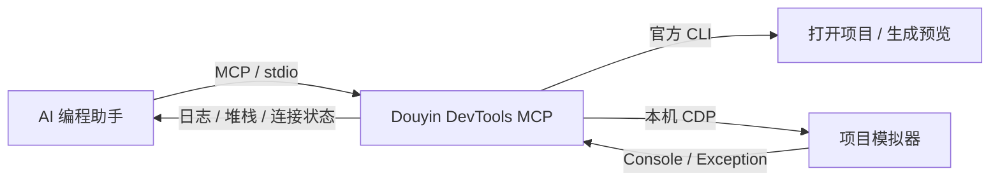

# Douyin DevTools MCP

**让 AI 编程助手直接读取抖音小游戏日志，完成从发现错误到验证修复的开发流程。**

[](LICENSE)
[](package.json)

简体中文 · [English](README.en.md) · [快速开始](#快速开始) · [工具文档](docs/tools.md) · [问题反馈](https://github.com/linayanc/DouyinDevToolsMCP/issues)

Douyin DevTools MCP 是一个开源的 [Model Context Protocol（MCP）](https://modelcontextprotocol.io/) 服务，为 Codex 等本地 AI 编程客户端连接抖音开发者工具。它提供项目打开、Console 日志读取、错误筛选、增量日志跟踪和预览码生成能力，减少在 IDE 与聊天窗口之间复制日志的操作。

编程助手负责分析问题和修改源码，本项目负责提供 IDE 操作与运行时日志。适用于抖音小游戏开发，以及需要接入 AI 辅助排错的开发流程。

> 当前版本：**v0.1.0**。已在 Windows、抖音开发者工具 4.5.6、官方 CLI 2.1.1 上实测打开项目与日志采集，并验证 Codex 原生 MCP 调用能够获取日志。Unity/Wasm 导出项目、macOS IDE 和真实账号预览上传仍待验证，详见[兼容性说明](docs/compatibility.md)。

## 功能介绍

| MCP 工具 | 功能 | 常见用途 |
| --- | --- | --- |
| `douyin_open_project` | 通过官方 CLI 打开小游戏，连接对应项目的模拟器 | 开始调试指定项目 |
| `douyin_get_logs` | 读取最近的 Console 日志，支持级别和文本筛选 | 了解运行情况、定位异常上下文 |
| `douyin_get_errors` | 读取 Error、Exception 及可用的堆栈 | 让助手分析报错位置 |
| `douyin_watch_logs` | 从上次读取位置或指定游标获取新增日志 | 检查重新编译后的输出 |
| `douyin_preview` | 调用官方 CLI 生成预览二维码 | 在有权限的账号下预览小游戏 |

- **按项目采集**：匹配指定项目的工作台与模拟器，隔离其他项目的日志。
- **结构化输出**：保留日志级别、时间、堆栈、游标与连接状态，便于助手分析。
- **持续排错**：支持有界日志缓存、增量分页、断线重连及可能丢失日志的提示。
- **本地运行**：使用 stdio 与 MCP 客户端通信，连接本机 IDE 调试端口。



## 快速开始

### 1. 准备环境

- Node.js **22 或更高版本**、npm 和 Git。
- 已安装并启动的[抖音开发者工具](https://developer.open-douyin.com/docs/resource/zh-CN/mini-game/develop/dev-tools/developer-instrument-update-and-download)。当前建议使用已实测的 Windows 环境。
- 一个包含 `project.config.json` 的抖音小游戏目录；也可以先用仓库中的示例工程。
- 支持本地 stdio MCP 服务的客户端，并与开发者工具运行在同一台机器上。

### 2. 安装与构建

```sh
git clone https://github.com/linayanc/DouyinDevToolsMCP.git
cd DouyinDevToolsMCP
npm ci
npm run build
npm install -g tt-minigame-ide-cli
```

本项目目前通过源码安装，**尚未发布 npm 包**。`tt-minigame-ide-cli` 是单独安装的抖音官方 CLI，已实测版本为 2.1.1；安装时若取得其他版本，请结合[兼容性说明](docs/compatibility.md)检查。

启动 IDE 后，可在终端检查本地环境：

```sh
node dist/index.js --doctor
```

该命令检查 Node、官方 CLI 和 IDE 调试端口。具体项目是否已连接，需要在打开项目后检查工具返回的 `connection.state`。

### 3. 接入 Codex

在 Codex 用户配置 `~/.codex/config.toml` 中添加下列内容。Windows 的配置通常位于 `%USERPROFILE%/.codex/config.toml`。

```toml
[mcp_servers.douyin]
command = "node"
args = ["D:/tools/DouyinDevToolsMCP/dist/index.js"]
startup_timeout_sec = 15
tool_timeout_sec = 150
```

将 `args` 改成你的仓库**绝对路径**；Windows 路径可使用 `/`。如果客户端无法找到 Node，将 `command` 改成 `node.exe` 的绝对路径。保存配置后重新启动客户端，确认工具列表中出现上述五个工具。

若官方 CLI 未被自动发现，可追加：

```toml
[mcp_servers.douyin.env]
DOUYIN_CLI_PATH = "C:/Users/YOUR_USER/AppData/Roaming/npm/node_modules/tt-minigame-ide-cli/bin/tmg.js"
```

运行 `npm root -g` 可查询全局模块目录，在该目录下定位 `tt-minigame-ide-cli/bin/tmg.js`。请使用 JavaScript 入口路径，不要填写 `tmg.cmd`。完整模板见 [examples/codex.toml](examples/codex.toml)，配置字段见 [Codex MCP 官方文档](https://learn.chatgpt.com/docs/extend/mcp?surface=cli)。

### 其他 MCP 客户端

支持 `mcpServers` 配置格式的本地客户端可参考以下示例；具体配置位置以客户端文档为准。

```json
{
  "mcpServers": {
    "douyin": {
      "command": "node",
      "args": ["D:/tools/DouyinDevToolsMCP/dist/index.js"]
    }
  }
}
```

同样需要替换绝对路径。预览可能耗时较长，建议将客户端工具超时设为至少 150 秒。包含 CLI 路径的完整示例见 [examples/mcp.json](examples/mcp.json)。其他客户端尚未逐一实测。

## 使用方法

### 读取错误并验证修复

接入后，可以对编程助手说（将路径替换为你的项目目录）：

> 使用 douyin_open_project 打开 D:/games/my-douyin-game，确认模拟器已经连接，然后读取最新错误和相关日志，分析并修复问题。重新编译后用 douyin_watch_logs 检查新增输出，并结合连接状态说明修复是否得到验证。

对应的工具调用顺序如下。这些是 MCP 工具参数示例，无需粘贴到终端执行：

```text
douyin_open_project({"projectPath":"D:/games/my-douyin-game"})
douyin_get_errors({"limit":20})
douyin_get_logs({"contains":"加载","limit":50})
douyin_watch_logs({"waitMs":6000,"limit":100})
```

一个 MCP 进程同时维护一个活动项目。再次成功打开项目会建立新日志会话并重置游标；需要完整读取增量日志时，使用返回的 `nextCursor` 分页。参数和返回字段见[工具文档](docs/tools.md)。

### 用示例工程验证接入

让助手打开本仓库的 `examples/hello-game` **绝对路径**，然后读取日志。示例会主动输出 log、warn、error，抛出示例异常，并每 5 秒输出一次 tick；这些报错是用于验证采集链路的演示内容。

也可以在仓库目录运行 MCP 冒烟测试，替换下面的路径：

```sh
npm run smoke -- D:/tools/DouyinDevToolsMCP/examples/hello-game
```

该测试会打开本地项目、读取错误并等待新增日志，不调用预览上传。

### 生成预览码

先在终端运行 `tmg login`，确保项目使用有效 AppID，且登录账号拥有对应权限。然后让助手为当前项目调用 `douyin_preview`，或显式传入项目绝对路径：

```text
douyin_preview({"projectPath":"D:/games/my-douyin-game"})
```

**预览会上传项目代码到抖音平台生成二维码**，不会提审或发布正式版本。二维码通过 MCP 图片与本地文件路径返回，文件保存在系统临时目录。示例工程使用测试 AppID；真实账号的预览上传仍待实测。

## 配置说明

环境变量通过 MCP 客户端的 `env` 配置传入。程序不会自动加载 `.env` 文件。

| 环境变量 | 默认行为 / 说明 |
| --- | --- |
| `DOUYIN_CLI_PATH` | 自动查找官方 CLI；可指定绝对 `.js/.cjs/.mjs/.exe` 路径 |
| `DOUYIN_CDP_ENDPOINT` | 自动从 IDE 日志发现端口；可指定 `http://127.0.0.1:端口` |
| `DOUYIN_IDE_LOG_PATH` | 指定 IDE 的 `logs/main.log`，仅用于发现调试端口 |
| `DOUYIN_ALLOWED_ROOTS` | 默认不限制项目目录；可用 JSON 数组限定允许访问的绝对根目录 |
| `DOUYIN_LOG_CAPACITY` | 内存缓存条数，默认 `2000`，范围 `10–10000` |

例如，在 Codex 的 `[mcp_servers.douyin.env]` 配置段中添加 `DOUYIN_ALLOWED_ROOTS = '["D:/games","D:/builds"]'`，可限制项目访问范围。

## 兼容性与常见问题

| 验证范围 | 当前状态 |
| --- | --- |
| Windows + IDE 4.5.6 + CLI 2.1.1 | 已实测项目打开、日志、错误、重新编译后采集与断线重连 |
| Codex 原生 MCP 调用 | 已验证工具发现以及打开项目、读取日志、错误和增量日志 |
| 真实账号预览上传 | 命令和图片返回已通过模拟集成测试，真实上传待验证 |
| Unity/Wasm 导出项目、macOS IDE | 待真实工程验证 |
| 真机日志、独立 worker | 当前版本未覆盖 |

**找不到 CLI？** 运行 `npm root -g` 后显式配置 `DOUYIN_CLI_PATH`，确认客户端能访问 Node 和该文件。

**项目已打开，却没有日志？** 检查 `connection.state` 是否为 `connected`，确认模拟器已启动，并运行 `--doctor` 排查调试端口。`opened: true` 只表示官方 CLI 已处理打开请求。空日志不代表项目没有错误。

**可以打开 Unity 项目吗？** 传入的应是包含 `project.config.json` 的抖音小游戏导出目录，而非 Unity 工程根目录；Unity/Wasm 兼容性仍需实际导出工程验证。

**日志采集有何限制？** 日志依赖 IDE 的本地 CDP 调试接口，该接口并非官方承诺稳定的日志 API。连接前的完整历史、断线期间的日志和原始源码 source map 还原均不保证；返回的连接状态、`dropped` 和 `possibleGapCount` 可帮助判断数据是否完整。

更多排障信息见[兼容性说明](docs/compatibility.md)。本项目面向抖音小游戏，当前不提供微信开发者工具适配、截图、模拟器点击或 UI 自动化测试。

## 文档与参与贡献

欢迎提交 Issue、改进文档、贡献代码，或提供可复现的兼容性样例。尤其欢迎不同 IDE 版本、macOS 和 Unity/Wasm 工程的脱敏验证结果。

| 文档 | 内容 |
| --- | --- |
| [工具文档](docs/tools.md) | 参数、日志格式、游标语义与错误码 |
| [兼容性说明](docs/compatibility.md) | 实测环境、支持范围与排障 |
| [贡献指南](CONTRIBUTING.md) | 开发环境、提交规范和问题反馈 |
| [安全说明](SECURITY.md) | 日志隐私、访问范围与漏洞报告 |
| [路线图](ROADMAP.md) | 后续适配和功能计划 |
| [更新记录](CHANGELOG.md) | 版本变更 |
| [发布说明](docs/releasing.md) | 维护者发布检查与流程 |

本地开发检查：

```sh
npm ci
npm run verify
npm pack --dry-run
```

`verify` 执行类型检查、自动化测试与构建。自动化测试不依赖真实 IDE 或账号；CI 配置覆盖 Windows、macOS、Linux 上的 Node 22/24，真实 IDE 的兼容性单独验证。

## 开源许可与隐私

本项目采用 [MIT License](LICENSE)，允许使用、修改、分发和商业使用，分发时需保留版权和许可声明。软件按现状提供，不作担保；完整条款以 LICENSE 为准。贡献代码采用同一许可，详见[贡献指南](CONTRIBUTING.md)。

这是独立的社区项目，与抖音、字节跳动及其他相关平台无隶属或官方背书关系。抖音开发者工具和官方 CLI 需自行安装，其使用遵循各自的条款。

MCP 服务自身不包含遥测。日志会传给你配置的 AI 客户端，官方 CLI 有独立的登录与上传行为。日志脱敏为尽力处理，公开反馈前仍需检查敏感信息，详见[安全说明](SECURITY.md)。

## 联系与支持

- 问题反馈与功能建议：[GitHub Issues](https://github.com/linayanc/DouyinDevToolsMCP/issues)。
- 作者联系方式：[1772997956@qq.com](mailto:1772997956@qq.com)，欢迎交流使用体验与合作想法。
- 安全漏洞：请通过上述邮箱私下报告，避免在公开 Issue 中披露敏感细节。

如果这个项目对你有帮助，欢迎点一个 **Star**，也欢迎分享可复现的使用案例，帮助更多小游戏开发者接入 AI 开发流程。
